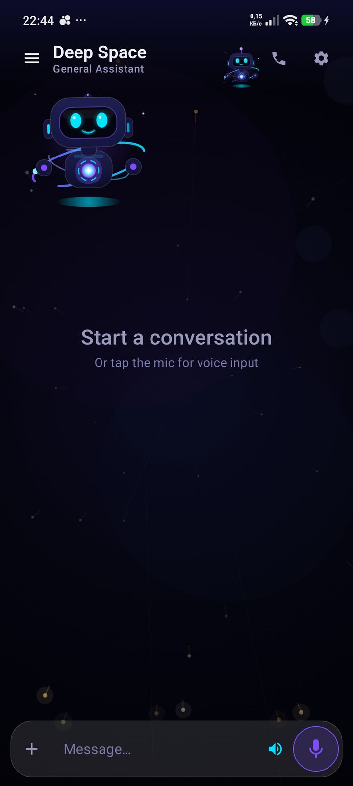
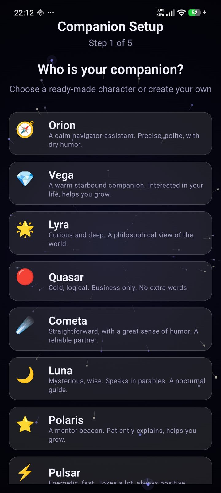
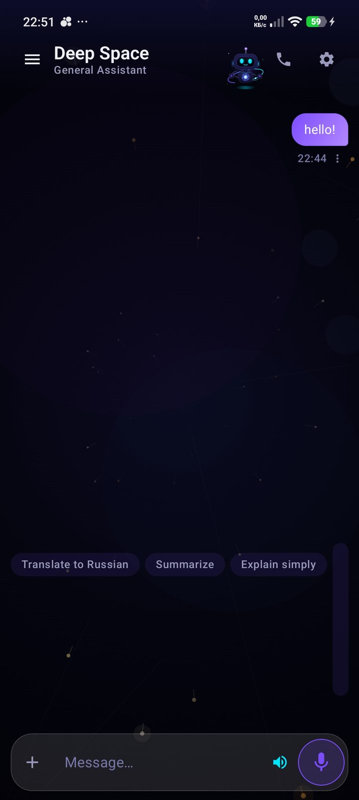

# Tinariox

**Local-first AI-компаньон для Android.** Разговаривает голосом, помнит вас, помогает с задачами — на LLM, **которую выбрали вы**: локально (Ollama, LM Studio) или через облачный OpenAI-совместимый endpoint. Без аккаунта Tinariox.

> **Ранняя бета.** Возможны ошибки. Часть экспериментальных возможностей ещё в разработке и **не входит** в эту сборку. Что работает сейчас — в таблице ниже.

[English](README.md)

**🆕 Новое: [v20.0.5](../../releases/tag/v20.0.5)** — Сад памяти (просмотр, правка и «забыть»: всё, что помнит компаньон), улучшенный RAG по документам, фиксы чата. Подробнее — [CHANGELOG](CHANGELOG.md).

<p align="center">
  
  
  
</p>

## Что работает в этой бете

| Область | Что есть |
|---------|----------|
| **Чат** | Стриминг с LM Studio, Ollama, KoboldCpp, text-generation-webui или любым OpenAI-совместимым сервером (LAN или облако) |
| **Голос** | Распознавание и озвучка прямо на устройстве (STT/TTS) |
| **Компаньон** | Личности, настроение, знакомство при первом запуске — не безликий бот |
| **Память** | Сад памяти: факты о вас (поиск, правка, «забыть»), обрывки диалогов, граф знаний |
| **Задачи** | Напоминания словами, виды списка и календаря |
| **Документы** | PDF и вопросы по вашим файлам |
| **Ваш endpoint** | Локальный сервер или облачный OpenAI-совместимый API — на выбор; с локальной моделью разговоры остаются в вашей сети |

Ещё экраны: [навигация](docs/screenshots/navigation.jpg), [задачи](docs/screenshots/tasks.jpg), [настройки](docs/screenshots/settings.jpg).

## Установка

1. Скачайте APK со страницы [Releases](../../releases).
2. Разрешите установку из этого источника.
3. Откройте приложение и укажите адрес LLM-сервера.

**Требования:** Android 8.0+ (API 26), **arm64**.

**APK:** `Tinariox-20.0.5-demo.apk` (~214 MB — со встроенными моделями речи).

**SHA-256 (v20.0.5-demo):**

```
C60419E959D0BDC7F2C692424FF2223133568F4424248A2190036EA28BE7C585
```

Проверка после скачивания:

```powershell
Get-FileHash .\Tinariox-20.0.5-demo.apk -Algorithm SHA256
```

## Подключение к LLM-серверу

| Способ | Как |
|--------|-----|
| **Wi-Fi / LAN** | Запустите LM Studio или Ollama на компьютере в той же сети. В настройках укажите IP компьютера (например `192.168.1.10`). Есть автопоиск в локальной сети. |
| **Облако** | Тип сервера `OpenAI-compatible` + URL провайдера. |

## Обратная связь

Нашли баг или есть идея — создайте [issue](../../issues). Укажите модель телефона, версию Android и какой LLM-сервер используете.

## Поддержать проект

Tinariox бесплатный. Если приложение полезно, можно поддержать дальнейшую разработку — новые голоса, стабильность и модули, которые ещё в работе:

- **Boosty:** [boosty.to/severnyiveter/donate](https://boosty.to/severnyiveter/donate)
- **USDT (Solana):** `AexDs2eE1HBPLoBM3HGMkkfdSNjZQuVn8F72rTYtSGLv`

Донаты добровольны и не открывают платных функций — всё в приложении остаётся бесплатным.

## Лицензия

Tinariox — бесплатное проприетарное ПО. Исходный код закрыт. Подробнее — [LICENSE](LICENSE).

Сторонние компоненты — [THIRD_PARTY_NOTICES.md](THIRD_PARTY_NOTICES.md).

---

<sub>Tinariox — локальный AI-компаньон. Ваши данные остаются у вас.</sub>
